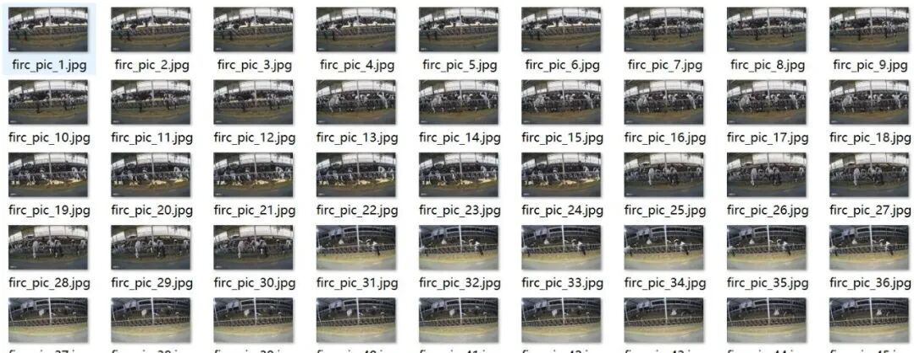
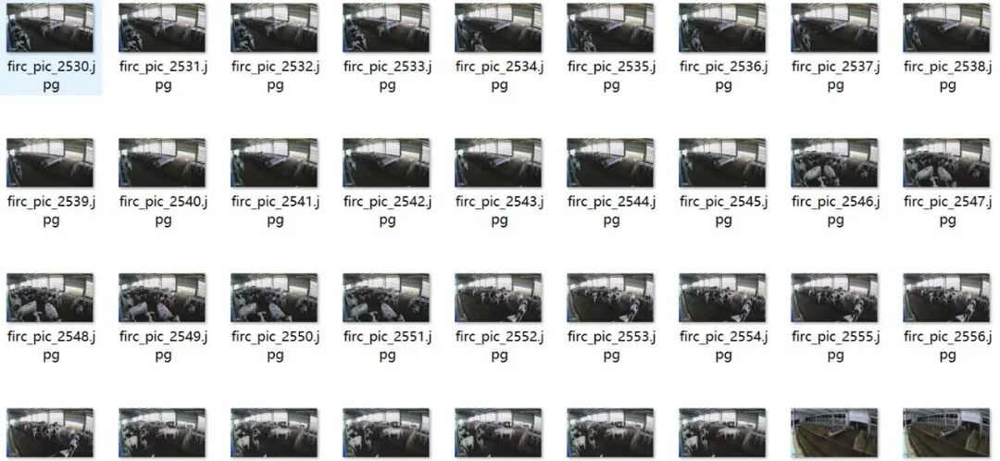
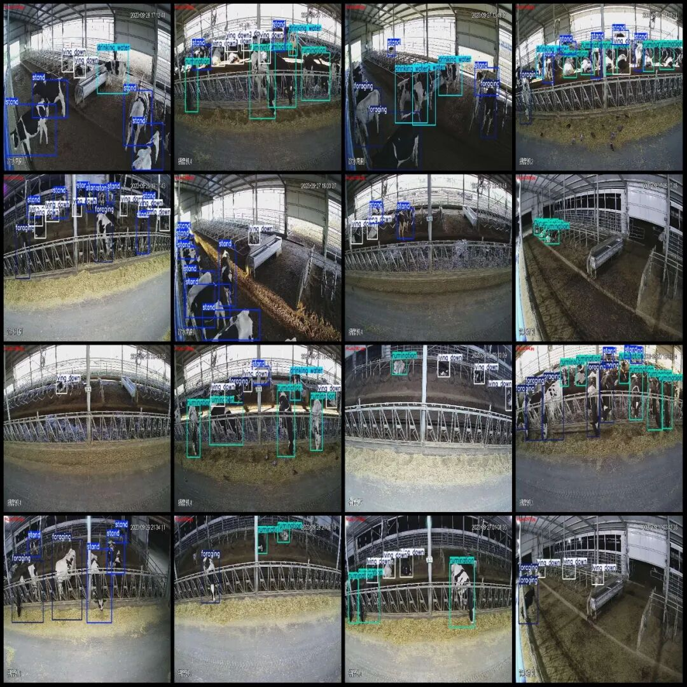
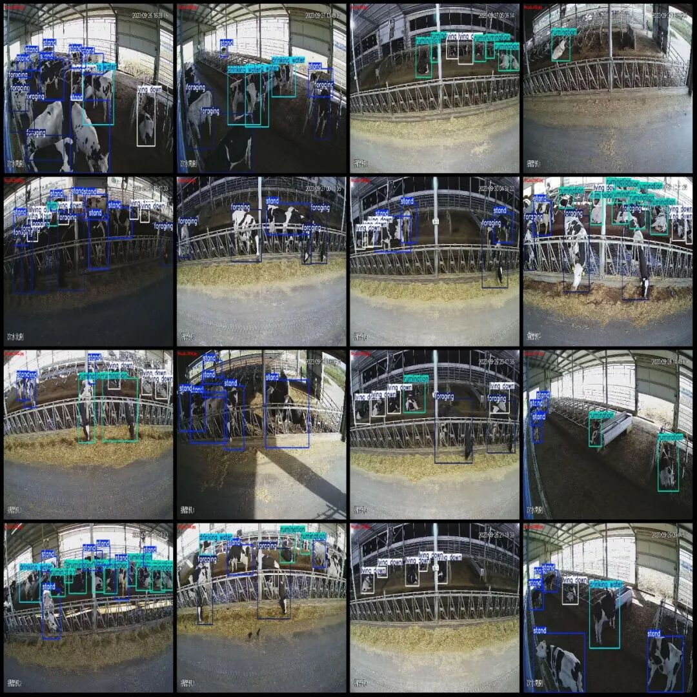
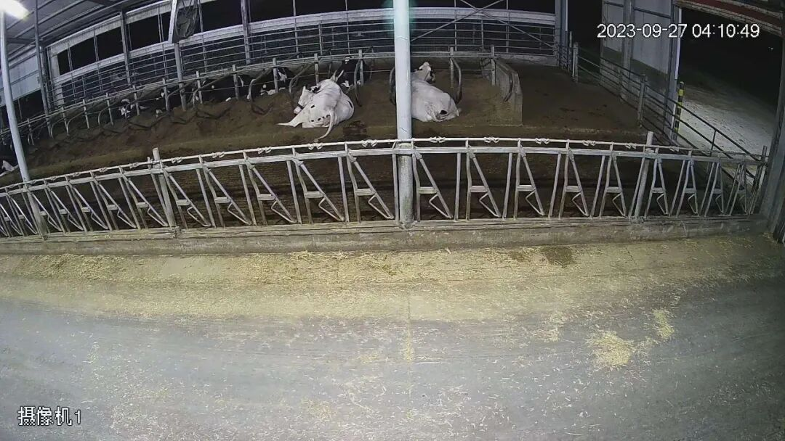
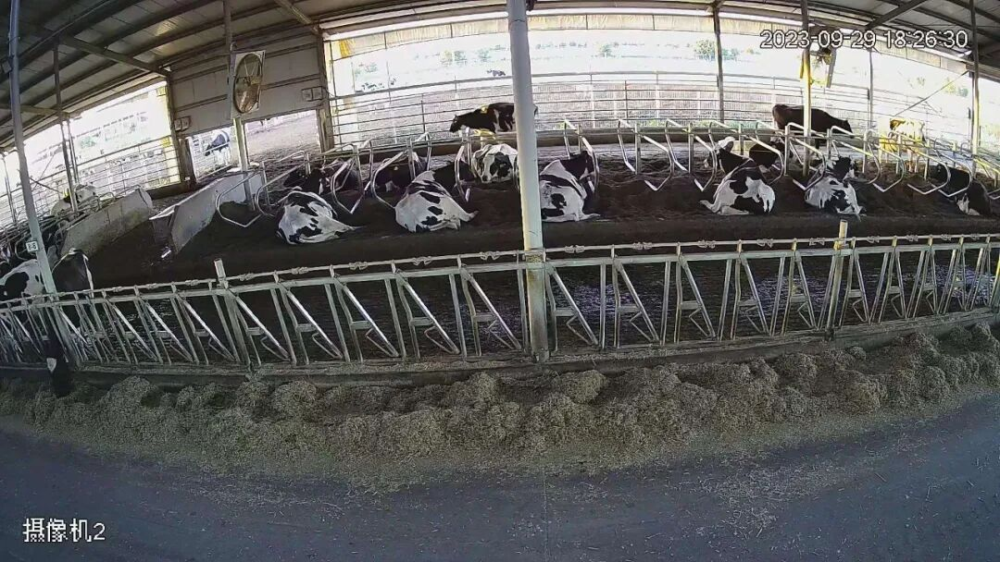
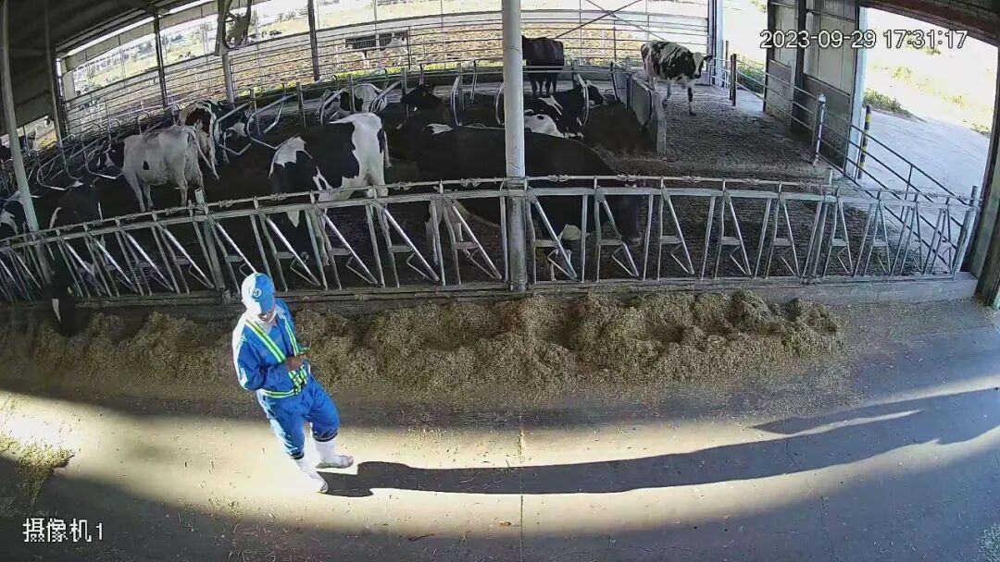

# Livestock farm behavior detection dataset VOC+YOLO format with 3198 images in 5 categories

Please note that the dataset images are screenshots from different camera angles taken at various times, and specific details can be seen in the images.

Dataset format: Pascal VOC format + YOLO format (txt file without split path, only containing jpg images and corresponding VOC format xml files and yolo format txt files)

Number of images (number of jpg files): 3198

Number of annotations (number of xml files): 3198

Number of annotations (number of txt files): 3198

Label category count: 5

Label category names (note that the order of categories in the YOLO format does not correspond to this, but is based on the labels folder's classes.txt): ["drinking water", "foraging", "lying down", "rumination", "stand"]

Number of boxes labeled in each category:

drinking water (water) frame count = 717

Foraging (hunting) frame count = 5646

lying down (lying down) frame count = 4569

Rumination (regurgitation) frame count = 6011

Standing frame count = 8357

Total frames: 25300

Number of images per category:

Drinking water (Water) occupies a picture count = 610

Foraging (hunting) occupies 1560 images.

lying down (lying on) occupies = 1647

Rumination (regurgitation) occupies the number of images = 1969

Stand (standing) Ownership count = 2373

Image resolution: 1920x1080

Using labelImg:

Annotation rules: Draw a rectangle around the category.

Important Notice: The dataset does not have separate training, validation, and test sets; you need to partition them yourself.

Special : This dataset does not guarantee the accuracy of the trained models or weight files.

Image Preview:

Annotation example:

Single image:

## Payment

Here is a pay link on Stripe ( https://buy.stripe.com/3cs8yP7sY87d0vu9AB ). Please contact me lonlonago@foxmail.com after funding $89, and I will send you a complete data files , thank you!

